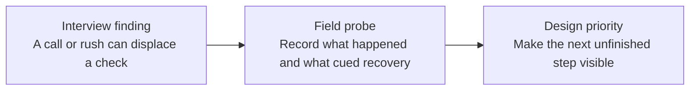

# Remembering in Motion

**A personal HCI research project on everyday memory, interruptions and task resumption**

**Researcher** [@katherine0292](https://github.com/katherine0292) · **Context** Human-centred design research, 2026

A property manager put her keys beside the cup holder to take a call. When the call ended, she searched the bag where the keys usually lived. A glance across the car finally revealed them. In another incident, she remembered checking a lease folder but had to start over because she could no longer tell which step she had completed.

Those incidents revealed two different design problems. People can lose track of an object's temporary location or lose track of their progress through a task. I used a two-week field probe to follow those problems from the interruption to the moment the participant noticed and recovered.

## Research approach

I explored everyday remembering in two phases. **When the Body Remembers** examined how 15 participants carried belongings, checked that they were ready to leave and noticed omissions. The interview analysis contains **356 coded entries, 26 clusters and six themes**. **Interrupted Rituals** followed one property manager over two weeks. Ten recorded incidents helped me trace what interrupted a check, when she noticed a problem and how she recovered.

The interview findings showed that bags, pockets and familiar locations can stand in for a list of belongings. A call or rush can displace the physical check that normally verifies that everything is ready. I used that finding to design the field probe around the next cue the participant encountered.

I used WeChat for short voice notes, photos and one-tap reactions, and drew a map of usual item locations with the participant. At handoff she declined the planned keyring tag because it would add bulk to her work keys. I moved the prompt to an eraser she could keep on her desk or in her bag. This let her choose when and how to record an incident during a busy workday.

The participant recovered through visual cues, an expected touch that was missing, another person's message or a planned check at the point of use. A missed send step was harder to detect because the documents were already prepared. I proposed making unfinished work visible when people return to it. The study ended with design hypotheses and a plan for evaluating them.

## Explore the project

| Document | What it covers |
| --- | --- |
| [Research brief](RESEARCH-BRIEF.md) | The retrospective brief, research questions, phase-by-phase scope and corresponding deliverables |
| [Interview study](research/interview-study.md) | Semi-structured interviews, six themes and counterexamples that refined the field question |
| [Field probe study](research/field-probe-study.md) | The two-week deployment, five findings, selected incidents and methodological limitations |
| [Research instruments](methods/research-instruments.md) | Interview guides, the probe kit, field prompts and participant-facing safeguards |
| [Design opportunities](research/design-opportunities.md) | Four evidence-linked concepts and a proposed evaluation |
| [Evidence and sources](evidence/README.md) | The source inventory, reporting decisions and aggregate cluster summaries |

## Visual portfolio

[Open the interactive portfolio page](https://katherine0292.github.io/HCI-Research/) (English and Chinese). It replays five incidents, shows the kit from draft to final, and links each claim to material from the study: the participant's field photos, the Spot Map, and the Miro affinity wall that takes 159 codes to 25 clusters and five themes. The source is in [`site-src/`](site-src/); `python3 make_data.py .. > data.json` then `python3 build.py` (run inside `site-src/`) rebuilds `index.html`.

The [Aura hero artwork](img/banner/remembering-in-motion-aura-v1.png) is 2172 × 724 (3:1), matching CircleU's banner proportions. A key, unfinished papers and a reconnecting ribbon represent item location and interrupted task progress. The page renders the title as live text over the artwork, fills the page width and caps the banner height at 600px. The desktop introduction keeps its headline on one line; the five incident replays appear in the Question chapter. The [ImageGen prompt](img/banner/prompt.txt) and a [page preview](img/banner/page-preview-zh.jpg) are included with the asset.

Download the standalone [1920 × 1200 poster](img/banner/remembering-in-motion-1920x1200.png), recomposed in 8:5 with the title and caption included. Its [generation prompt](img/banner/prompt-1920x1200.txt) is included alongside the PNG.

This portfolio presents aggregate findings, paraphrased field examples and research instruments. The participant's photos were taken and shared with consent, and the page also shows the blank consent form template. The original transcripts and chat logs stay with the original study materials.

## Interaction checks

With Node.js, Playwright and Google Chrome installed, run `node tests/interactions.cjs`. The check serves the built page locally and uses real pointer clicks at desktop and phone sizes, in both languages. It covers chapter navigation, menus, filters, tabs, photo groups, image zoom, close/previous/next controls, keyboard dismissal, email copying and reference links. It also checks that the last menu item remains reachable on a short landscape screen. Reference destinations are stubbed after the click; publisher availability is outside this check.

Set `PLAYWRIGHT_MODULE` to use an existing Playwright module path, `BROWSER_CHANNEL` to select another installed Chrome/Chromium channel, or `BASE_URL` to check a deployed build.
