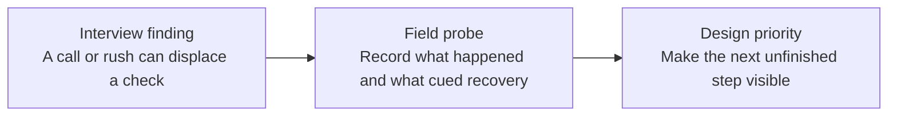

# Remembering in Motion

**An HCI research case study on everyday memory, interruptions and task resumption**

**Researcher** [@katherine0292](https://github.com/katherine0292) · **Context** Human-centred design research, 2026

A property manager put her keys beside the cup holder to take a call. When the call ended, she searched the bag where the keys usually lived. A glance across the car finally revealed them. In another incident, she remembered checking a lease folder but had to start over because she could no longer tell which step she had completed.

Those incidents revealed two different design problems. People can lose track of an object's temporary location or lose track of their progress through a task. I used a two-week field probe to follow those problems from the interruption to the moment the participant noticed and recovered.

## My contribution

| Study | Scope | My contribution |
| --- | --- | --- |
| **When the Body Remembers** | Team interview study with 15 participants and five independent coders. The shared analysis produced 356 code entries, 26 clusters and six themes. | My documented interview work includes two participant records and 54 descriptive and analytic coding entries. The cross-participant findings are the team's work. |
| **Interrupted Rituals** | Individual follow-up with one property manager over two weeks. Ten recorded incidents and four source types informed five findings. | I framed the follow-up question, designed and adapted the probe kit, ran the introductory and exit interviews, documented the field material, coded it in two passes, and wrote the research report and design implications. |

## From interviews to the field

The team interviews showed how people use bags, pockets, fixed locations and physical checks to remember belongings. They also showed that calls, conversations and time pressure can push a check out of the departure routine. I designed the follow-up to find out what would bring the interrupted action back to mind.

I used WeChat for short voice notes, photos and one-tap reactions, and drew a map of usual item locations with the participant. At handoff she declined the planned keyring tag because it would add bulk to her work keys. I moved the prompt to an eraser she could keep on her desk or in her bag. This let her choose when and how to record an incident during a busy workday.

The participant recovered through visual cues, an expected touch that was missing, another person's message or a planned check at the point of use. A missed send step was harder to detect because the documents were already prepared. I proposed making unfinished work visible when people return to it. The study ended with design hypotheses and a plan for evaluating them.

## Explore the project

| Document | What it covers |
| --- | --- |
| [Research brief](RESEARCH-BRIEF.md) | The retrospective brief, research questions, phase-by-phase scope and corresponding deliverables |
| [Interview study](research/interview-study.md) | The interview method, six team findings, counterexamples and my documented contributions |
| [Field probe study](research/field-probe-study.md) | The two-week deployment, five findings, selected incidents and methodological limitations |
| [Research instruments](methods/research-instruments.md) | Interview guides, the probe kit, field prompts and participant-facing safeguards |
| [Design opportunities](research/design-opportunities.md) | Four evidence-linked concepts and a proposed evaluation |
| [Evidence and sources](evidence/README.md) | The source inventory, reporting decisions and aggregate cluster summaries |

This private portfolio presents aggregate findings, paraphrased field examples and research instruments. The original transcripts, chat logs, photos and consent paperwork stay with the original study materials.
