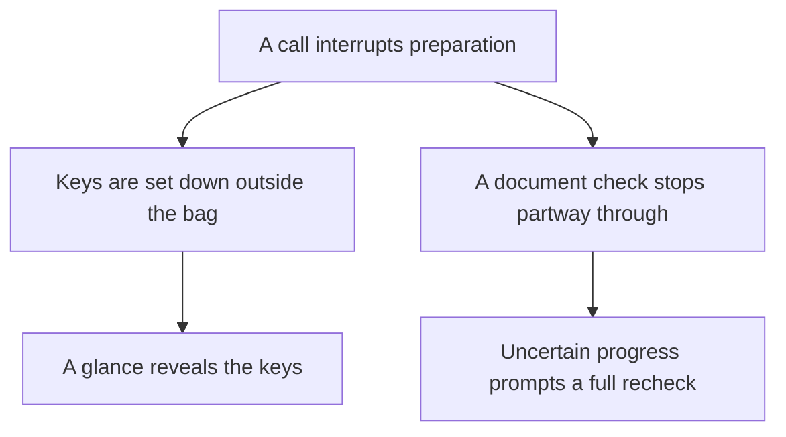

# Interrupted Rituals

**Individual HCI study · two weeks in October 2026 · one property manager**

## Research question

How does someone notice a forgotten or misplaced item after a call or conversation interrupts their usual check? I also tracked what happened when the item was present but the participant could no longer tell which action she had completed.

## Research design and deployment

I recruited a property manager who regularly prepared keys and paperwork while moving between an office, a car and property entrances. She already labelled key sets, used naming conventions for work contacts and checked labels again at the door. She was separate from the team interview sample.

I began with a semi-structured interview about routines and near misses, then drew a Spot Map with the participant to record where keys, paperwork and the phone usually went in each setting. The initial kit design included a prompt attached to her keyring. She explained that another tag would get in the way, so I transferred the prompt to an eraser that could sit on her desk or travel in her bag.

The participant used the kit on ordinary workdays. In WeChat, she could send a quick reaction during a safe pause, add a photo for spatial context, or use a short voice note to explain the sequence. I used the exit interview to walk through the incidents, compare them with the usual routine and ask whether reports or photos had been created later.

Over two weeks the record contained **10 incidents, nine reaction stickers, 10 photos and eight voice notes**. Eight of the 10 reported incidents followed a call or conversation. The [field protocol](../methods/research-instruments.md#field-probe-protocol) explains the role of each instrument.

## Analysis

I coded the probe log, introductory interview, exit interview and Spot Map separately. In the first pass I described what each extract showed. In the second I interpreted how the action, setting or cue contributed to the interruption or recovery. I then grouped related entries on an affinity board and reviewed the clusters against the source material.

| Source | Coded entries | What it contributed |
| --- | ---: | --- |
| WeChat probe record | 53 | Reported events, photos, voice notes, reactions and clarifying exchanges |
| Introductory interview | 35 | Baseline routines, earlier near misses and existing workarounds |
| Exit interview | 54 | Reconstruction of events, cues, reporting gaps and participant feedback |
| Spot Map | 17 | Familiar item locations and checkpoints across the three settings |
| **Total** | **159** | **25 clusters** |

I developed five findings from 21 clusters containing 122 entries. Four further clusters, with 37 entries, described how the method shaped the material and informed my reflection. Code counts describe the analysis record. Several entries can come from the same incident or from the participant's later account of it. See the [probe cluster summary](../evidence/probe-clusters.csv).

## Findings

| Finding | Code entries | Interpretation |
| --- | ---: | --- |
| **Interruptions can move items out of the routine** | 26 | An occupied hand or changed sequence can lead to a temporary set-down or a grab of the wrong item. A folder moved to make room also produced a slip without a call. |
| **Familiar item locations guide search** | 23 | The participant checked the bag or front seat first because that was where the item usually lived. Picking up the bag could feel like confirmation that everything was ready even when the folder was elsewhere. |
| **A check can lose its place halfway through** | 23 | After a call, the participant could remember opening a folder but was unsure which details she had verified. In a separate event, preparing a bill felt like completing the task even though it had yet to be sent. |
| **The next available cue determines when recovery begins** | 25 | A glance, a reach into an empty bag, a tenant's message or a planned door check could reveal a problem. Reported delays ranged from minutes to the next time the item was needed. |
| **Consequences shape the checks people keep** | 25 | Costly earlier mistakes led to labels and a second check at the door. The participant also described how a small visible prompt helped her pause and recall a pending action. |

## Selected incidents

These examples paraphrase the field accounts. The evidence IDs refer to the original analysis board and report.

| Incident | What changed | First cue or recovery action | Evidence |
| --- | --- | --- | --- |
| Keys by the cup holder | A call interrupted a key check. The keys were set beside the cup holder and the usual search started in the bag. | A glance across the car exposed the temporary location. | P-05–P-09, E-05–E-08 |
| Folder by the printer | A question interrupted preparation and the folder stayed near the printer after the bag was picked up. | Returning to turn off the printer brought the folder into view. | P-11–P-14, E-09–E-10 |
| Similar key sets | The participant selected the wrong set while sorting keys during a call. | Her existing tag check before attempting to open the door caught the selection. | P-16–P-19, E-12–E-14 |
| Folder verification | A call interrupted the address and document-type check. The folder was present and correct, but the participant was unsure what she had checked. | She reopened it and repeated the check from the beginning. | P-31–P-34 |
| Prepared bill | The participant stepped away after preparing the paperwork and later believed the bill had been sent. | A tenant's message prompted her to check the email and discover the missed send. | P-46–P-49, E-33–E-36, E-42 |

The folder and bill incidents led me to distinguish visible item state from less visible task progress. A missing item can eventually produce a sensory cue. A prepared document can look the same whether its final action is pending or complete. This distinction informed the [design opportunities](design-opportunities.md).

## What the study can support

This is an exploratory case study with one convenience-sampled participant. The findings describe plausible mechanisms in one work setting. The number of reports reflects what she had time to capture and what the kit made easy to record. Message timestamps indicate when she shared material. Some photos were reconstructed after the event, and the study did not measure time to detection continuously.

An occasional check-in prompted delayed reporting. I also sometimes summarised what I thought had happened and asked for confirmation, which could shape the participant's account. Drawing the map and using the kit could increase her attention to checking. The participant's account of the eraser supports testing a pause cue. The study design cannot establish its effect on error rates.

In a follow-up, I would ask the participant to mark whether a record was contemporaneous, recalled or recreated. I would also invite her to reconstruct the sequence in her own words before offering my interpretation. Those changes would make the evidence easier to interpret while preserving the flexibility that made the probe usable.
